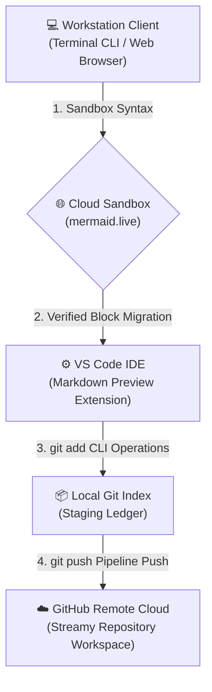
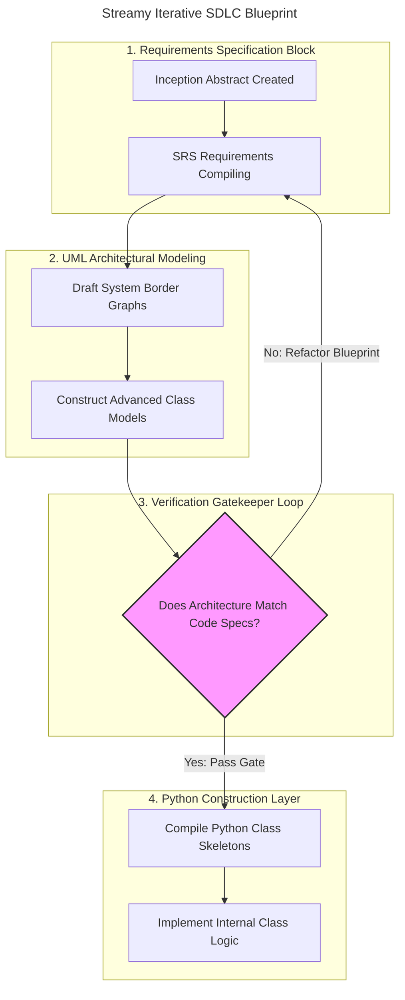
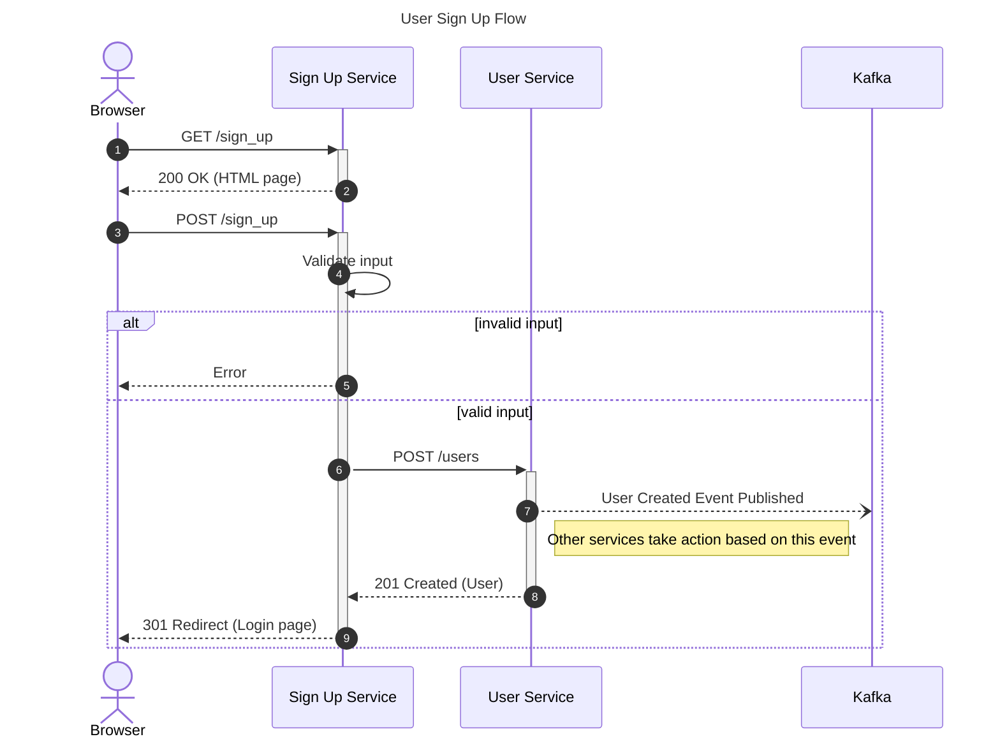

# Streamy Video Streaming Backend Platform 
 
## Software Technology Course Laboratory Node 
*   **Student Identity:** [Vagif Naghiyev] 
*   **Neptun System Code:** [H3QDUX] 
*   **Course Section Reference:** GEIAL314-B2a 
 --- 
 
## Workspace Environment Architecture 
The diagram below maps out how our development environment connects local code 
authoring to remote version tracking, using a **Diagrams-as-Code** design pipeline. 
 

## Streamy Application Engineering Development Lifecycle

To guarantee systematic software tracking across the implementation lifespan of **Streamy**, our individual developer pipeline follows the structured iterative gate review framework illustrated below.

## User Sign Up Sequence Diagram

The following sequence diagram illustrates the Streamy user registration process, including synchronous communication, asynchronous event publishing, input validation, and alternative execution paths.

