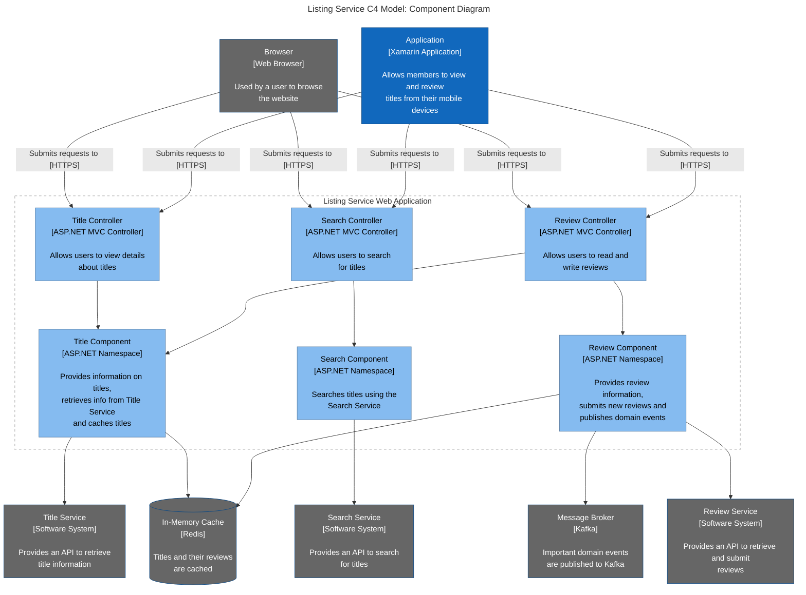

# Streamy Component Architecture

## 1. Listing Service Component Diagram

This diagram models the internal controllers and components of the Listing Service Web Application, together with its callers and external dependencies.

# Streamy Component Architecture

## 1. Listing Service Component Diagram

This diagram models the internal controllers and components of the Listing Service Web Application, together with its callers and external dependencies.

