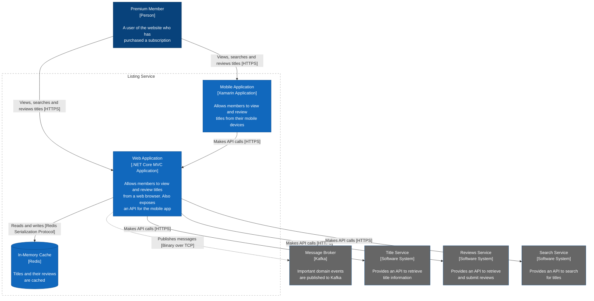

# Streamy Container Architecture

This diagram illustrates the Listing Service container architecture, including its web and mobile applications, Redis cache, Kafka message broker, and supporting external services.

