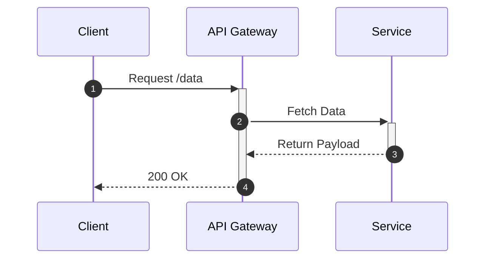

# System Architecture Documentation

Welcome to the automated documentation site for the Streamy Video Streaming Backend Platform.

This website is generated automatically using GitHub Actions, Mermaid CLI, and GitHub Pages.

## Service Flow

