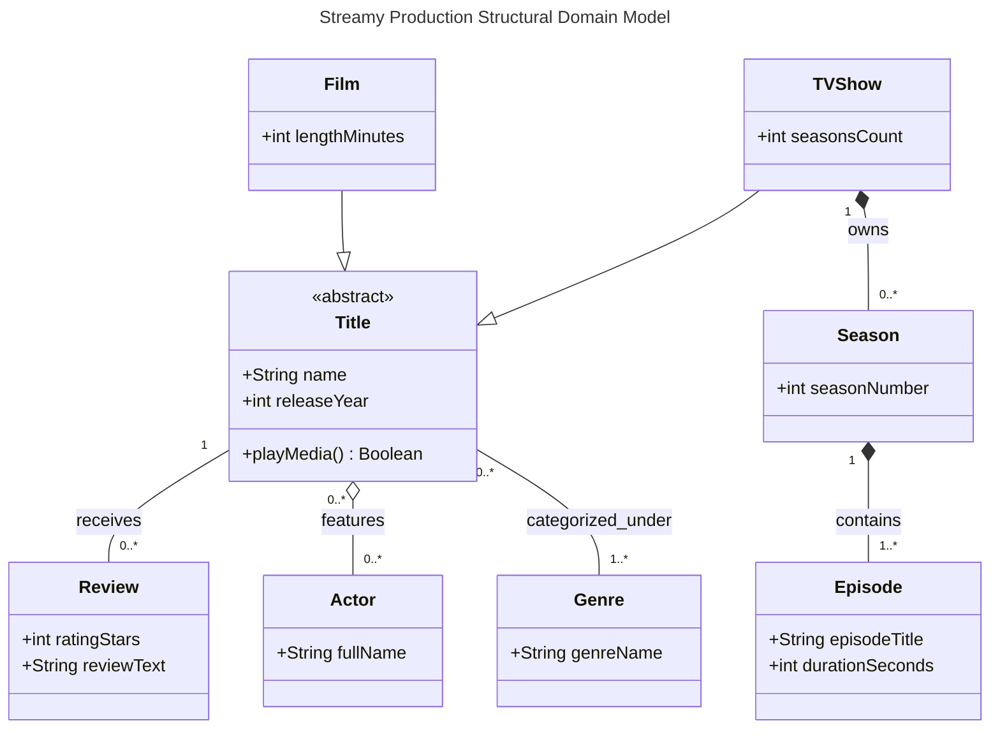

# Streamy Core Domain Structural Architecture

## Foundational Object-Oriented Entity Specifications

### 1. Conceptual Domain Breakdown

This tracking document establishes the structural domain model for the Streamy streaming platform. It defines the core classes, their attributes, inheritance hierarchy, and relationships to support the platform's object-oriented architecture.

### 2. Advanced Production Structural Class Diagram

The following class diagram models the Streamy domain entities, including inheritance, composition, aggregation, associations, and multiplicity constraints.

