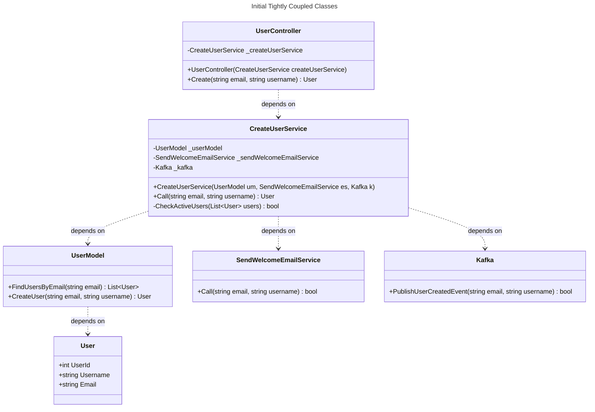
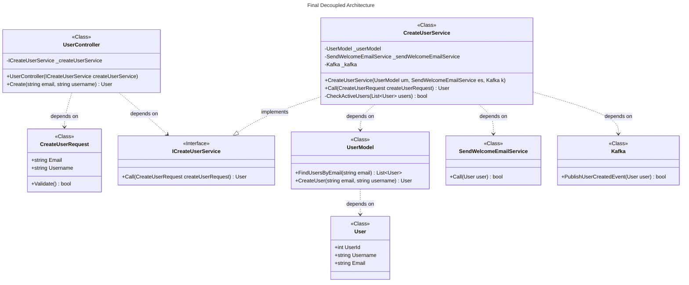

# Streamy Application Design and Refactoring
## UML Class Diagrams, Dependencies, and Interfaces

### 1. Initial Tightly Coupled Architecture

The initial registration design passes email and username separately through several method signatures. The controller also depends directly on the concrete registration service.

### 2. Code Smell Analysis

**Code Smell 1 — Data Clumps**

The `email` and `username` parameters repeatedly appear together across multiple method signatures. This creates duplicated parameter groups and makes future changes harder.

**Refactoring:** Introduce `CreateUserRequest` to encapsulate registration data and provide a `Validate()` method. The email and username are now passed together as one request object. Downstream notification services consume the `User` entity instead of separate primitive parameters.

**Code Smell 2 — Tight Coupling**

`UserController` initially depends directly on the concrete `CreateUserService`. This makes the controller dependent on a specific implementation.

**Refactoring:** Introduce the `ICreateUserService` interface. The controller depends on the interface, while `CreateUserService` implements it. This applies the Dependency Inversion Principle and reduces direct coupling.

### 3. Final Decoupled Architecture

### 4. Implementation Note

These diagrams describe a proposed Streamy registration architecture. The current repository contains architectural documentation rather than an implemented backend, so the classes and method signatures shown here are illustrative and have not been verified against production source code.