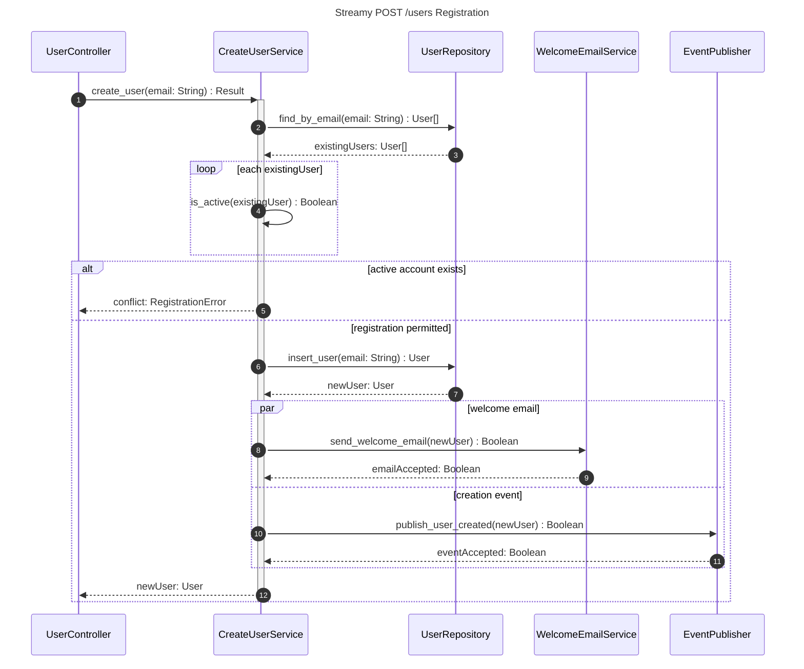

# Streamy User Registration Sequence

## 1. POST /users — Account Registration

This sequence diagram illustrates a proposed Streamy account-registration workflow. Method signatures and return types are illustrative architectural examples.

## 2. Architectural Code Smell Analysis

- **Leaky Abstraction:** Iterating over all matched users may be inefficient. A repository method such as `exists_active_by_email(email)` could provide a more efficient alternative.
- **Side-Effect Coupling:** Sending emails and publishing events during registration can complicate retries and partial failures. An event-driven worker and transactional outbox could improve reliability.

### 2.1 Leaky Abstractions

The service retrieves all users matching an email address and iterates through them to check whether an account is active. This may be inefficient when multiple records are returned.

**Suggested improvement:** Introduce a repository method such as `exists_active_by_email(email)` and enforce appropriate database uniqueness constraints.

### 2.2 Side-Effect Coupling

The registration service sends a welcome email and publishes a user-created event as part of the registration workflow. If either operation fails, retries and partial failures may become difficult to manage.

**Suggested improvement:** Consider using an event-driven background worker and, where reliable delivery is required, a transactional outbox pattern.

### 2.3 Concurrency Consideration

The `par` block represents the intended concurrent execution of email delivery and event publishing. It illustrates a possible architectural design and does not prove that the implementation is actually non-blocking.

## 3. Implementation Note

The method signatures and return types in this diagram are illustrative. The parallel block represents a proposed concurrent design, not verified runtime behavior.
